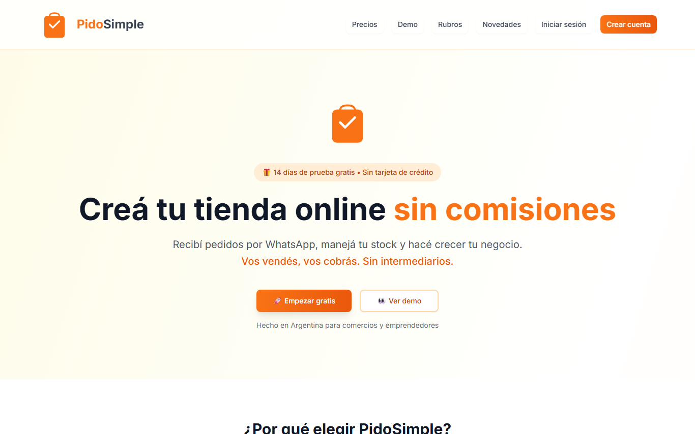
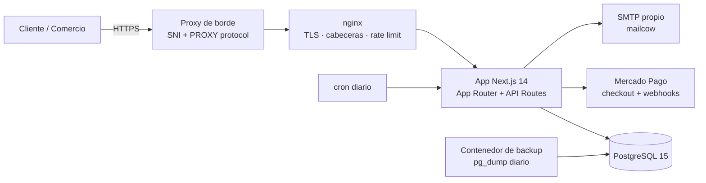

# PidoSimple

**Plataforma SaaS multi-tenant para que cualquier comercio tenga su tienda online con catálogo, pedidos y cobros.**

> 🇬🇧 **English summary.** Multi-tenant SaaS where merchants create an online store at `pidosimple.com/{slug}`,
> manage products and receive orders, with Mercado Pago checkout per store and subscription billing for the platform.
> Built with Next.js 14, Prisma and PostgreSQL, self-hosted with Docker. Includes full 2FA (TOTP or email + recovery
> codes), an AppSec audit (17 findings, 15 fixed in production), programmatic SEO by business type, and an operations CLI
> for admins. Source code is private; this repo documents the product and its architecture.

---

## El problema

Un comercio chico (rotisería, almacén, emprendimiento) necesita vender online sin pagar un e-commerce
completo ni depender de un desarrollador. PidoSimple le da una tienda lista en minutos, con link propio
para compartir por WhatsApp e Instagram, y el pedido le llega ordenado.

## Funcionalidades

**Para el comercio**
- Tiendas con URL propia (`pidosimple.com/{slug}`), logo e imágenes optimizadas.
- Catálogo con alta, edición e **importación masiva** de productos.
- Gestión de pedidos y clientes, analítica de la tienda.
- Cobro con **Mercado Pago** configurado por tienda (checkout + webhook).
- Límites por plan y suscripción a la plataforma, con avisos de vencimiento.

**Para el cliente final**
- Tienda pública sin registro, carrito y confirmación del pedido.
- Página de éxito con el estado del pedido.

**Para el administrador de la plataforma**
- Panel de usuarios, tiendas, suscripciones (extender, recordar, cambiar estado), reportes, métricas y changelog público.
- CLI de operación en el servidor: reset de contraseña, alta de admin, desactivar 2FA, cerrar sesiones,
  backup/restauración, prueba de email. Las acciones sobre cuentas exigen TTY interactiva y quedan logueadas.

## Arquitectura

- **Monolito Next.js** (App Router para UI, Route Handlers para la API REST: ~70 endpoints).
- **Roles:** `ADMIN` (plataforma), `MERCHANT` (comercios), cliente final anónimo.
- **Modelo:** `User`, `Subscription`, `Store`, `StoreSlugRedirect`, `Product`, `Order`, `OrderItem`,
  `ProcessedWebhook` (idempotencia de pagos), `Changelog`.
- **Contenedores:** app (usuario sin privilegios, `node:20-alpine`), Postgres y un contenedor de backup programado.

## Seguridad

Auditoría AppSec propia (OWASP Top 10 2025 / API Top 10 / ASVS 5.0): **17 hallazgos** documentados,
15 corregidos en producción y 2 en seguimiento. Entre otras cosas:

- **2FA completa:** app TOTP o código por email, 10 códigos de recuperación guardados con HMAC.
- **Revocación de sesiones** por `tokenVersion` (cambio de clave, cierre remoto).
- Recuperación de contraseña con tokens de un solo uso; avisos de seguridad por email.
- **Webhooks idempotentes** (`ProcessedWebhook`) para no procesar dos veces un pago.
- Validación con Zod, rate limiting, Helmet, subida de imágenes saneada con Sharp.
- Plantillas de email con escape de HTML; sin credenciales por defecto en el panel admin.

## SEO

- Landings programáticas por rubro (`/tienda-online/[rubro]`).
- **Redirecciones 301** automáticas cuando un comercio cambia su slug (`StoreSlugRedirect`).
- Open Graph por tienda, sitemap y metadata por página.

## Operación

- Deploy por Docker Compose detrás de nginx + Let's Encrypt.
- Backup diario de Postgres con restauración probada.
- Cron diario autenticado con secreto para recordatorios de suscripción.
- Correo transaccional por un servidor de mail propio (SPF/DKIM/DMARC).

## Mi rol

Producto, desarrollo, infraestructura, auditoría de seguridad y operación: todo el ciclo.

---

Código privado (producto comercial de Anhur Dynamics). Este repositorio documenta el producto y su arquitectura.
